# Itzitzo Jobs Feed Software Architecture

## Stack
- **Backend:** Java 17 on AWS Lambda; no application server or Spring runtime.
- **Frontend:** No frontend application; RSS readers consume the public HTTP feed.
- **Database:** Amazon DynamoDB with string partition/sort keys and transactional writes.
- **Email and AI:** Amazon SES, private S3 storage, and Amazon Nova through Bedrock Converse.
- **Testing:** JUnit 5, Mockito, and Terraform tests with a mocked AWS provider.
- **Build:** Gradle Wrapper, Shadow JAR, Lambda ZIP packaging, Terraform, and GitHub Actions OIDC.

## Overview

Itzitzo Jobs Feed turns received job emails into a public RSS 2.0 feed.
One Lambda application handles two independent event paths:

1. An SES receipt rule stores the raw email in S3, then invokes Lambda asynchronously.
   The application parses MIME, extracts structured jobs using Nova, and atomically
   writes jobs and a processed-message marker to DynamoDB.
2. API Gateway invokes the same Lambda synchronously for `GET /feed.xml`.
   The application queries the latest jobs, renders RSS XML, and returns HTTP 200.

- DynamoDB is the source of truth for published feed records and completed-message markers.
- S3 retains raw email for recovery; it is not queried when serving RSS.
- Bedrock is called during ingestion, never during an RSS request.
- A Lambda asynchronous failure destination captures failed invocations in SQS;
  SQS is not an ingestion trigger or application-managed worker queue.
- Internal direct-invocation actions remain available to authorized Lambda callers,
  but cannot be selected through HTTP.

This document describes the implemented source and Terraform configuration, not
an assertion that every resource or SES route is already deployed. SES integration
is disabled by default. Live email acceptance and Nova Micro/Lite evaluation
remain rollout tasks.

### Design Patterns

- **Ports and adapters:** `EmailReader`, `JobExtractor`, `JobStore`, and `BedrockGateway`
  separate orchestration from S3, MIME parsing, Bedrock, and DynamoDB.
- **Constructor injection:** Dependencies are assembled by the default Lambda constructor;
  tests supply fakes or mocks. There is no dependency-injection framework.
- **Thin inbound router:** `LambdaHandler` recognizes event sources and delegates
  ingestion and HTTP behavior instead of implementing either workflow inline.
- **Typed domain models:** `SesMessage`, `JobDetails`, and `Job` validate metadata,
  extraction fields, and stable publication identity.
- **Transactional idempotency:** A conditional completion marker and all jobs from
  one email commit in a single DynamoDB transaction.
- **Execution-environment reuse:** Clients and services are fields of the Lambda
  handler and can be reused across warm invocations; there is no global singleton
  spanning Lambda execution environments.
- **Externalized configuration:** Terraform supplies model, table, email, and feed
  settings through Lambda environment variables. AWS supplies the reserved region variable.

## Modules and technology

The repository contains one Gradle application, not multiple Gradle subprojects
or independently deployed Java services:

| Area | Purpose |
| --- | --- |
| `src/main/java/com/itzitzo/jobsfeed/LambdaHandler.java` | Lambda composition root and inbound event router. |
| `model/` | SES metadata, validated job details, deterministic IDs, and sort keys. |
| `service/` | Ingestion, MIME/S3 reading, Nova extraction, DynamoDB storage, HTTP responses, and RSS rendering. |
| `config/AwsClientsConfig.java` | AWS SDK v2 clients and request timeouts. |
| `src/test/` | Routing, ingestion, extraction, persistence, MIME, and RSS behavior checks. |
| `infra/` | Terraform resources, environment values, persistent state configuration, and mocked infrastructure scenarios. |
| `.github/workflows/deploy-lambda.yml` | Build, plan, infrastructure validation, and optional apply/deploy. |

The application uses AWS Lambda Java Core, AWS SDK v2 for Bedrock Runtime,
DynamoDB, and S3, Jackson for JSON, Angus/Jakarta Mail for MIME, Jsoup for
HTML-to-text conversion, the JDK StAX XML writer for RSS, and SLF4J for logging.

`shadowJar` merges dependencies and service descriptors into one JAR.
`lambdaZip` places it at `lib/app.jar` inside `build/deploy/lambda.zip`, matching
the Lambda Java runtime's classpath layout.

## System context

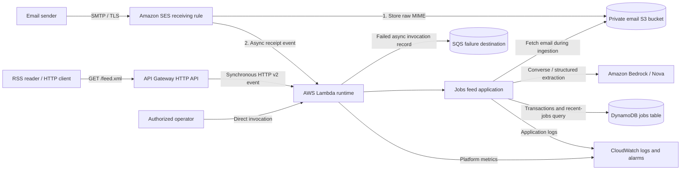

The feed endpoint is public and has no application authentication. Lambda invoke
permissions scope API Gateway and SES access to their intended resources.
Operators need IAM permission for direct actions and replay. Domain identity,
MX routing, an existing SES receipt rule set, and GitHub's OIDC role are external
prerequisites rather than resources automatically activated by this application.

## C4 - level 3 component diagram

This level-3 view opens the Java Lambda application into its code components:

- **Inbound adapters** distinguish SES, HTTP API v2, and internal direct actions.
- **Application services** orchestrate ingestion or feed delivery.
- **Domain models and policies** validate input and define publication identity.
- **Outbound ports** describe email reading, extraction, persistence, and direct inference.
- **Outbound adapters** implement those ports with AWS SDK clients and parsing libraries.

These are logical boundaries in one application, not enforced modules. The
default handler constructor knows concrete adapters, and the Bedrock adapter
also parses extraction JSON into domain objects.

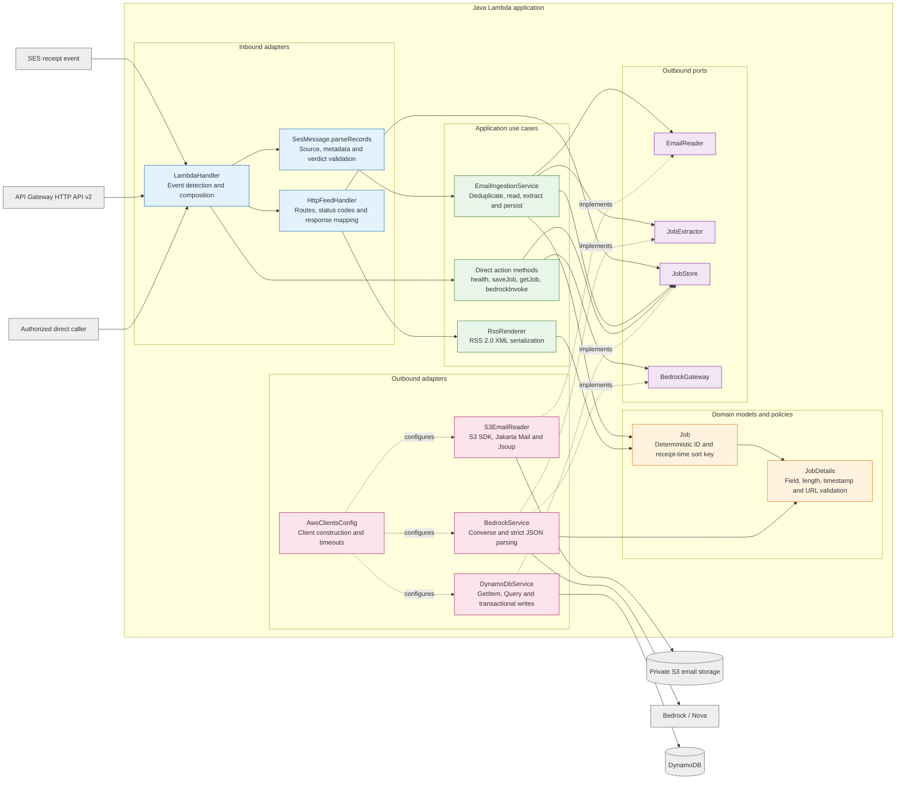

The runtime collaboration view separates normal application calls from
AWS-managed retries, failure delivery, and storage lifecycle behavior:

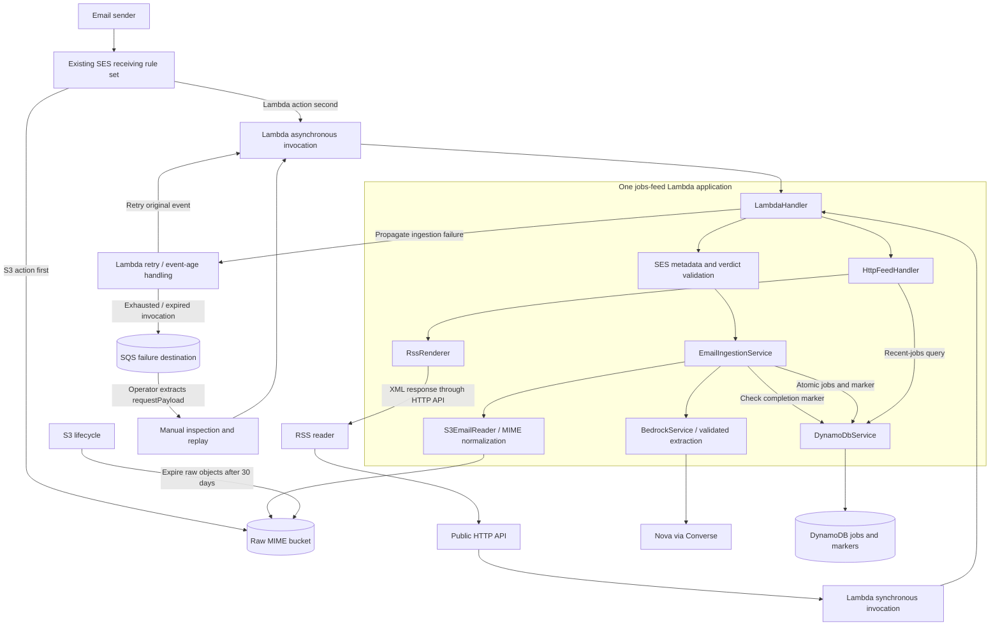

No SQS consumer, scheduler, web server, or separate inference service runs inside
the Java application. The failure queue has no Lambda event-source mapping.

### Component responsibilities (hexagonal mapping)

| Component | Responsibility |
| --- | --- |
| `LambdaHandler` | Assemble dependencies, prioritize HTTP-shaped events, validate SES batches, delegate workflows, and retain internal direct actions. |
| `SesMessage` | Validate every record before processing; require SES source, valid message ID/timestamp, and accepted receipt verdicts. |
| `EmailIngestionService` | Skip completed messages, read normalized email, extract jobs, create deterministic job records, and request one atomic write. |
| `EmailReader` / `S3EmailReader` | Retrieve only the configured bucket/prefix, bound raw size, parse MIME, prefer plain text, and normalize HTML without network fetches. |
| `JobExtractor` / `BedrockService` | Invoke the configured Nova model/profile through Converse and validate extraction JSON before returning domain objects. |
| `BedrockGateway` | Preserve direct prompt invocation for authorized internal callers. |
| `JobDetails` | Require title/description; validate optional strings, field lengths, and application URL scheme/host. |
| `Job` | Derive a UUID from SES message ID and ordinal and format a fixed-width UTC sort key. |
| `JobStore` | Define legacy item access, completion lookup, atomic ingestion, and recent-jobs query operations. |
| `DynamoDbService` | Use strongly consistent marker/feed reads, conditional transactional completion, pagination, and typed record conversion. |
| `HttpFeedHandler` | Accept HTTP API v2, enforce the feed path and GET method, map responses, and return explicit 5xx on failures. |
| `RssRenderer` | Serialize channel/items, escape XML, replace invalid XML characters, and emit stable GUIDs and publication dates. |
| `AwsClientsConfig` | Construct reusable SDK clients with bounded request timeouts. |
| Terraform and AWS Lambda runtime | Provision resources and configure asynchronous retries, event age, failure capture, and alarms; these are not Java worker components. |

## Interfaces

### Lambda events and direct actions

| Interface | Input | Behavior |
| --- | --- | --- |
| SES receipt event | Nonempty `Records` array with `eventSource: aws:ses`, mail metadata, and receipt verdicts | Validate the complete batch, then process records sequentially. Return `status`, newly stored `jobCount`, and `duplicates`; throw on failure so asynchronous handling can retry. |
| HTTP API event | Payload `version: "2.0"` and `requestContext.http` | Delegate exclusively to the feed handler. A supplied `action` cannot select an internal operation. |
| `health` | Empty/null direct input or `{"action":"health"}` | Return `{"status":"ok","message":"ok"}` without probing AWS dependencies. |
| `saveJob` | `action`, optional `pk`, `sk`, and `payload` | Legacy `PutItem`; defaults to `pk=job`, a generated sort key, and `"{}"` payload. This is not typed feed ingestion. |
| `getJob` | `action`, required `pk` and `sk` | Read a legacy payload; return `status:error, code:not_found` if absent. This is not an HTTP 404 response. |
| `bedrockInvoke` | `action` and required `prompt` | Call Converse and return generated response text. |

Unknown direct actions and unsupported/mixed record sources fail explicitly.
The legacy write operation can overwrite a supplied key; authorized callers must
not use reserved feed or marker keys for arbitrary payloads.

### HTTP endpoints

| Method and path | Behavior |
| --- | --- |
| `GET /feed.xml` | Query up to 50 most recently received jobs; return RSS XML with HTTP 200. An empty feed is valid. |
| Other methods on `/feed.xml` | HTTP 405 with `Allow: GET`; no storage or model call. |
| Other paths | HTTP 404. API Gateway normally rejects unmatched paths before invoking Lambda; the handler also rejects them when invoked directly. |
| Malformed HTTP event passed to Lambda | HTTP 400 rather than falling back to an internal action. |
| Feed query/rendering failure | HTTP 500 with a generic text body and a logged failure type; never an empty success-shaped feed. |

Terraform uses `ANY /feed.xml` so unsupported methods reach the handler and receive
405 instead of API Gateway's default 404. The integration uses payload format v2
and the `$default` stage. There are no public health, job-write, or inference routes.

### Event and extraction request shapes

An SES invocation carries metadata rather than the full message body:

```json
{
  "Records": [{
    "eventSource": "aws:ses",
    "ses": {
      "mail": {
        "messageId": "example-message-1",
        "timestamp": "2026-10-22T12:00:00Z"
      },
      "receipt": {
        "spamVerdict": {"status": "PASS"},
        "virusVerdict": {"status": "PASS"},
        "dmarcVerdict": {"status": "PASS"},
        "spfVerdict": {"status": "PASS"},
        "dkimVerdict": {"status": "PASS"}
      }
    }
  }]
}
```

The bucket and prefix come from configuration, not event-supplied locations.
The reader fetches `<EMAIL_OBJECT_PREFIX><messageId>`. Message IDs must match
`[A-Za-z0-9_-]{1,256}`. Spam, virus, and DMARC must pass, plus at least one of SPF
or DKIM. Missing, failed, gray, or error verdicts are rejected.

Bedrock receives normalized subject/body text as a user message, separate from
the extraction system instruction. Expected generated JSON is:

```json
{
  "jobs": [{
    "title": "Java Developer",
    "company": "Example Company",
    "location": "Remote",
    "description": "Build Java services.",
    "applicationUrl": "https://example.com/jobs/java",
    "publishedAt": null
  }]
}
```

Only `jobs` is permitted at the root, with at most 20 entries. Title and description
are required; optional fields may be absent or null. Unknown job fields, duplicate
JSON keys, trailing JSON content, invalid types, and invalid timestamps are rejected.
`{"jobs":[]}` is a completed non-job email, not a processing error.

## Supported flows

The flow diagrams describe actual runtime collaboration. DynamoDB arrows
abbreviate SDK adapter calls. Only the ingestion transaction spans the jobs and
completion marker; S3 reads and Nova inference are outside that transaction.

| Flow | Trigger | Outcome |
| --- | --- | --- |
| [Email ingestion](#email-ingestion-flow) | SES receipt event after S3 delivery | Validated jobs and one completed-message marker, or explicit failure. |
| [Duplicate delivery](#duplicate-delivery-flow) | Replay or concurrent delivery of the same SES message | Skip completed work or lose the conditional write safely; no duplicate published items. |
| [Email normalization and extraction](#email-normalization-and-extraction-flow) | Ingestion of an unprocessed message | Bounded text and validated job details, never arbitrary raw model output. |
| [Raw-email expiry](#raw-email-expiry-flow) | S3 lifecycle eligibility | Raw object expiry without deleting published jobs or markers. |
| [HTTP feed request](#http-feed-request-flow) | RSS reader requests `/feed.xml` | Synchronous RSS response without reading S3 or invoking Nova. |
| [Asynchronous retry and failure capture](#asynchronous-retry-and-failure-capture-flow) | Ingestion throws or an event expires | AWS-managed retry or a failure record in SQS. |
| [Recent-jobs query](#recent-jobs-query-flow) | Valid HTTP GET | Descending, paginated partition query, not a table scan. |
| [Transactional ingestion](#transactional-ingestion-flow) | Validated extraction | Jobs and marker committed atomically, including zero-job completion. |
| [Health and operational reads](#health-and-operational-read-flow) | Authorized invocation or operator inspection | Lightweight health or existing logs/metrics/state; no dependency-readiness guarantee. |
| [Direct item access](#direct-item-access-flow) | Authorized legacy `saveJob` / `getJob` action | Opaque payload storage or lookup, separate from feed records. |
| [RSS rendering](#rss-rendering-flow) | Successful recent-jobs query | Escaped RSS 2.0 XML with stable GUIDs and dates. |
| [Failure replay and cleanup](#failure-replay-and-cleanup-flow) | Manual operator recovery | Replay original SES input and remove a failure message only after verification. |

Attachment/OCR processing, URL scraping, cross-email vacancy deduplication, user
accounts, feed caching, automatic SQS redrive, and a frontend are not implemented.

### Email ingestion flow

The receipt rule must store the message before asynchronously invoking Lambda.
`SesMessage.parseRecords` validates the complete event before any record is processed.

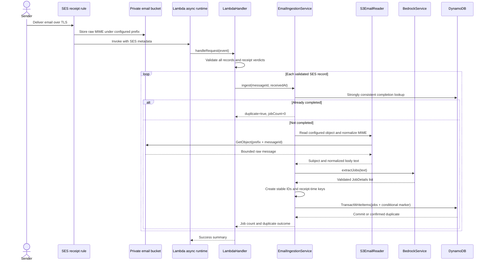

A valid email can produce zero to 20 jobs. No marker is written after a read,
MIME, inference, or validation failure. If a later record fails during processing,
earlier commits remain; the whole invocation fails and completion markers protect retries.

### Duplicate delivery flow

The marker lookup avoids routine repeat inference. The conditional transaction,
not the preliminary read, provides concurrency safety.

```mermaid
sequenceDiagram
    participant A as Ingestion A
    participant B as Concurrent ingestion B
    participant DB as DynamoDB
    participant Nova as Bedrock / Nova

    A->>DB: Read marker for message ID
    alt Marker already exists
        DB-->>A: Completed
        Note over A,Nova: Skip S3 read and inference
    else Marker absent
        DB-->>A: Not completed
        B->>DB: Read same marker
        DB-->>B: Not completed
        A->>Nova: Extract jobs
        B->>Nova: Extract jobs
        A->>DB: Transaction with marker-not-exists condition
        DB-->>A: Commit jobs and marker
        B->>DB: Transaction with same marker condition
        DB-->>B: Conditional cancellation; no writes applied
        B->>DB: Strongly consistent marker lookup
        DB-->>B: Confirm completion
        Note over B,DB: Return duplicate, not a second publication
    end
```

Only a cancellation whose marker condition failed and whose completion can be
confirmed is treated as a duplicate. Conflicts, throughput failures, and other
errors propagate. Concurrent deliveries can still incur duplicate model charges.

### Email normalization and extraction flow

`S3EmailReader` combines retrieval and MIME normalization. `BedrockService`
combines Converse invocation with strict response parsing.

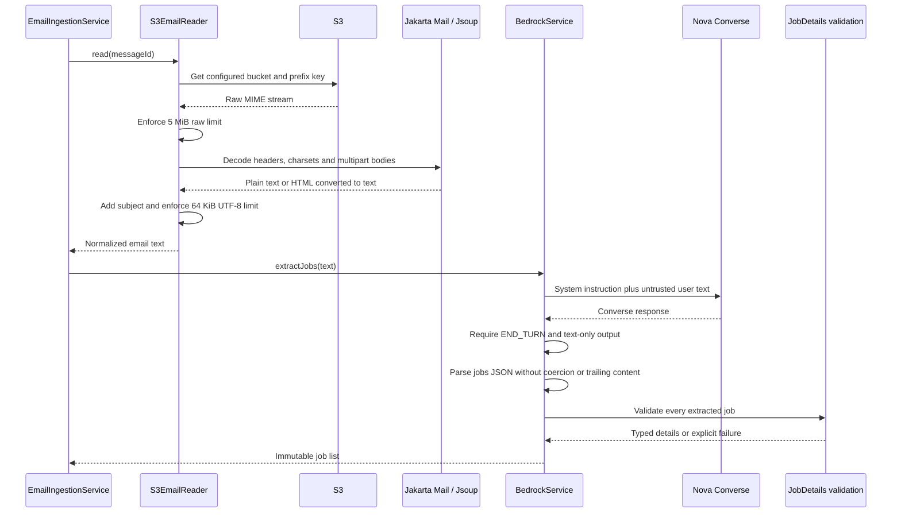

Plain text is preferred within multipart alternatives. Attachments and filename-bearing
parts are ignored. HTML conversion removes script/style content without fetching
remote resources. MIME traversal is bounded to depth 30 and 1,000 visited parts.

Nova requests use temperature `0.0` and an 8,192-token output budget. Incomplete,
empty, non-text, malformed, or oversized results fail instead of being truncated
or partially persisted. There is no automatic fallback to a different model.

### Raw-email expiry flow

Raw retention is an S3 lifecycle policy, not an application scheduler or a
DynamoDB TTL process.

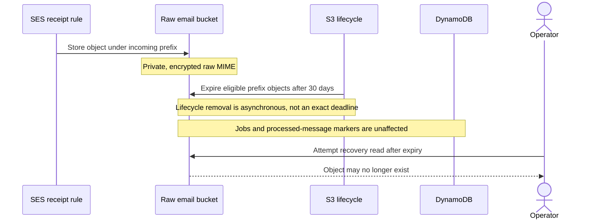

Processed markers have no expiry, so completed-message replay can still be skipped
after raw email deletion. A failed, unprocessed message cannot be recovered by
ordinary replay once its source object is gone. Incomplete multipart uploads
are also scheduled for cleanup after one day.

### HTTP feed request flow

RSS delivery is synchronous and independent of the inference path.

```mermaid
sequenceDiagram
    actor Reader as RSS reader
    participant API as API Gateway HTTP API
    participant Handler as LambdaHandler
    participant Http as HttpFeedHandler
    participant Store as DynamoDbService
    participant Render as RssRenderer

    Reader->>API: GET /feed.xml
    API->>Handler: HTTP API payload v2
    Handler->>Http: handle(event)
    Http->>Http: Validate version, method and path
    Http->>Store: recentJobs(50)
    Store-->>Http: Jobs ordered by receipt time
    Http->>Render: render(jobs)
    Render-->>Http: RSS XML string
    Http-->>API: statusCode=200, XML body, base64=false
    API-->>Reader: application/rss+xml; charset=utf-8
```

An empty result still returns a valid RSS channel and HTTP 200. Storage or XML
failures are logged and mapped to HTTP 500. The request does not read raw email,
invoke Bedrock, update markers, or select internal actions from query/body fields.

### Asynchronous retry and failure capture flow

The Java application propagates ingestion errors. Lambda's asynchronous
invocation configuration owns retries and failure-destination delivery.

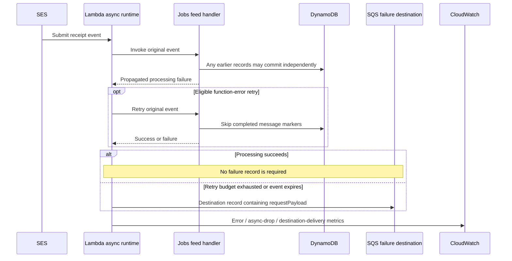

Terraform configures up to two function-error retries and a maximum event age
of one hour. Delivery remains at-least-once; these settings do not guarantee a
fixed total invocation count for every AWS delivery condition.

The encrypted queue retains failure records for up to 14 days. It contains a
destination envelope, not a raw SES event. Alarm notifications require configured
`alarm_actions`; an empty list records alarm state without notifying operators.

### Recent-jobs query flow

`DynamoDbService.recentJobs` queries one partition in descending sort-key order.
There is no scan, secondary index, or stored RSS document.

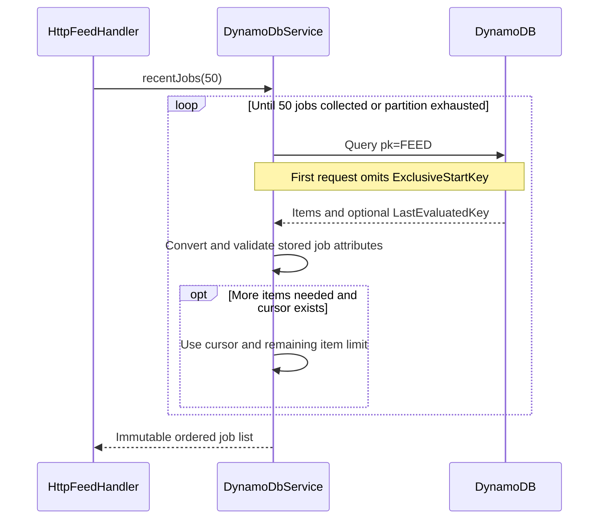

#### Feed-record meaning

Published items and completion markers have different key spaces:

```text
Feed job:          pk = FEED#jobs          sk = <fixed-width UTC receivedAt>#<jobId>
Completed email:   pk = EMAIL#<messageId>  sk = METADATA
```

A job contains validated details and internal source metadata. A marker contains
the extracted job count, including zero. The marker is a completion fact, not
an in-progress claim or distributed lock.

#### Ordering and pagination

Receipt time is normalized to UTC with nine fractional digits in the sort key.
The stable job ID breaks ties between jobs with the same receipt timestamp.

```text
2026-10-22T12:00:00.100000000Z#<job-id>
2026-10-22T12:00:00.000000000Z#<job-id>
```

Descending query order shows the first record above before the second.
`publishedAt` does not affect feed ordering. Each page is strongly consistent,
but multiple page reads are not one cross-page snapshot transaction.

### Transactional ingestion flow

Extraction must finish and all jobs must validate before the write is attempted.
No database transaction is held open during MIME parsing or inference.

```mermaid
sequenceDiagram
    participant Ingest as EmailIngestionService
    participant Model as Job identity
    participant Store as DynamoDbService
    participant DB as DynamoDB

    Ingest->>Model: From message ID, receipt time and ordinal
    Model-->>Ingest: Deterministic job records
    Ingest->>Store: saveIngestion(messageId, jobs)
    Store->>Store: Validate count, ownership, unique keys and size bounds
    Store->>DB: TransactWriteItems
    Note over Store,DB: First item is marker with attribute_not_exists(pk)
    Note over Store,DB: Remaining items are every job for this email
    alt All conditions succeed
        DB-->>Store: Jobs and marker committed together
        Store-->>Ingest: true
    else Marker condition loses a race
        DB-->>Store: Transaction canceled; no partial writes
        Store->>DB: Confirm existing marker consistently
        DB-->>Store: Completion exists
        Store-->>Ingest: false / duplicate
    else Other failure
        DB-->>Store: Transaction error
        Store-->>Ingest: Propagate error
    end
```

The adapter permits at most 20 jobs, rejects an estimated item size above
350 KiB, and rejects an estimated transaction payload above 3 MiB. These
application bounds leave room below DynamoDB's service limits.

#### Ingestion and duplicate-delivery example

| Step | DynamoDB state | Outcome |
| --- | --- | --- |
| Email A extracts two jobs | Two feed items and `EMAIL#A / METADATA` with count 2 commit together. | Both jobs become queryable. |
| Email A is replayed | Marker already exists. | No S3 read, inference, or additional publication. |
| Email B contains no vacancies | Only `EMAIL#B / METADATA` with count 0 is committed. | It is complete and will not be repeatedly inferred. |
| Email C fails extraction | No jobs or marker are written for C. | AWS retry or operator replay can attempt C again. |
| Another email repeats A's vacancy | Its SES message ID is different. | It may publish another item; cross-email deduplication is not implemented. |

### Health and operational read flow

The direct `health` action is a lightweight handler response, not a readiness
check for DynamoDB, S3, SES routing, or Bedrock model access.

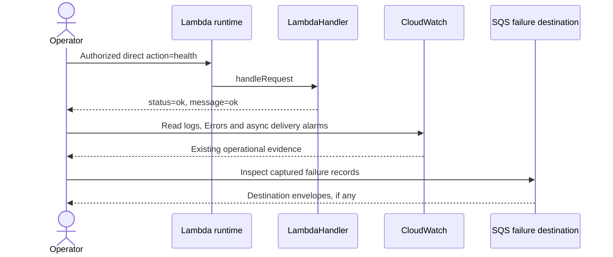

Application logs record message IDs, request IDs where available, job counts,
duplicate outcomes, durations, and failure types. Full MIME, prompts, generated
model responses, and sender details are not intentionally logged by the application.
There are no Actuator, Micrometer, MCP status, or background freshness endpoints.

### Direct item access flow

The legacy `saveJob` and `getJob` actions retain simple opaque-payload behavior.
They are for authorized direct invocations, not HTTP clients or email ingestion.

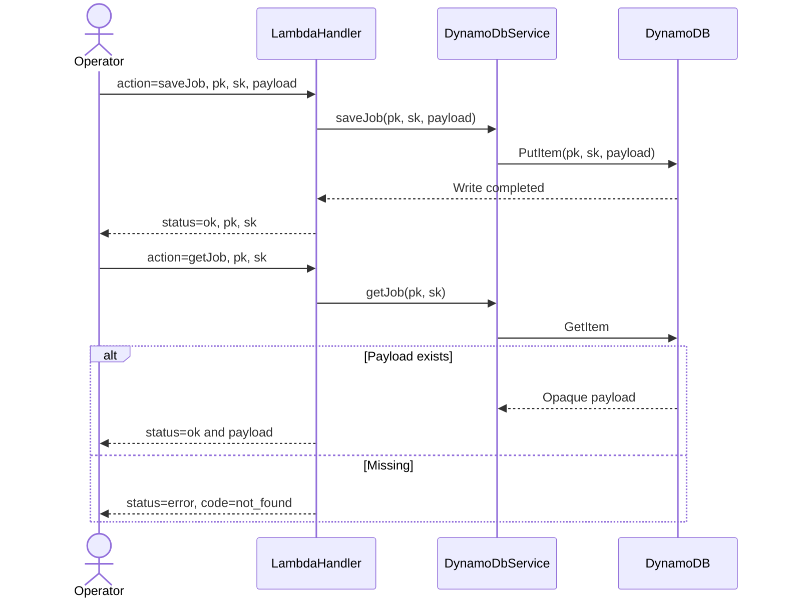

These records do not automatically appear in RSS: feed ingestion requires typed
attributes under `FEED#jobs`, not a generic `payload` string. This legacy read
also differs from the strongly consistent reads used for markers and feed queries.

### RSS rendering flow

`RssRenderer` serializes an already ordered list. It performs no database reads,
date-based reordering, email processing, or model calls.

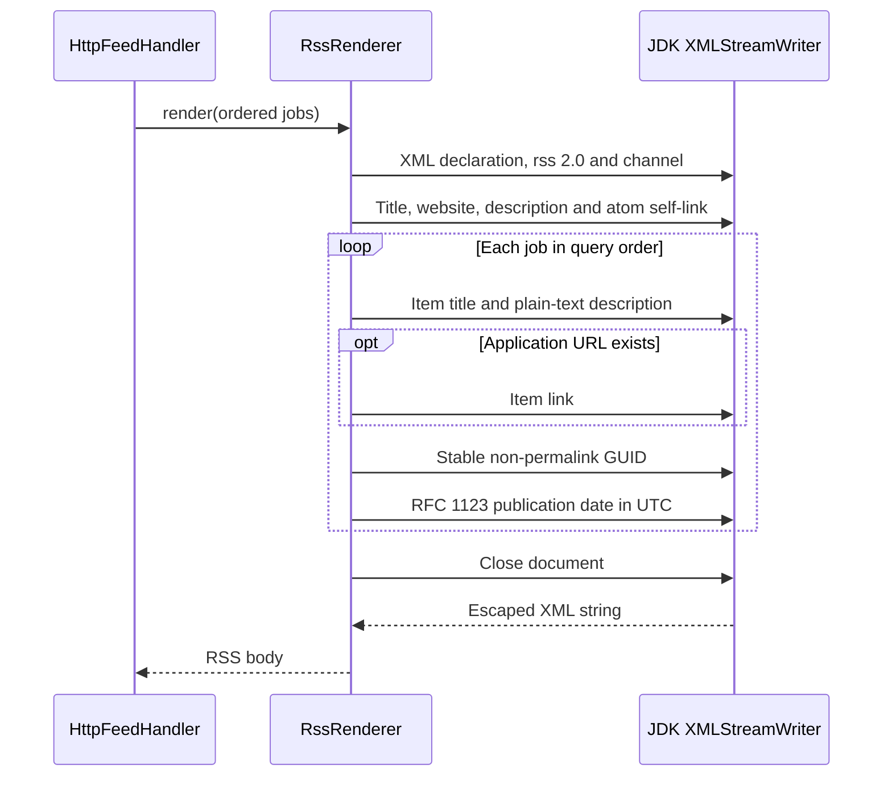

GUIDs use `urn:itzitzo:job:<jobId>` with `isPermaLink="false"`. Publication date
uses the validated source timestamp when present, otherwise receipt time.
Invalid XML characters are replaced with the Unicode replacement character.
Company and location are stored but do not have separate rendered RSS elements.
Raw MIME, sender addresses, and `sourceMessageId` are not serialized as item fields.

### Failure replay and cleanup flow

Recovery is a manual operator workflow using AWS interfaces, not an application
cleanup endpoint or an automatically attached queue consumer.

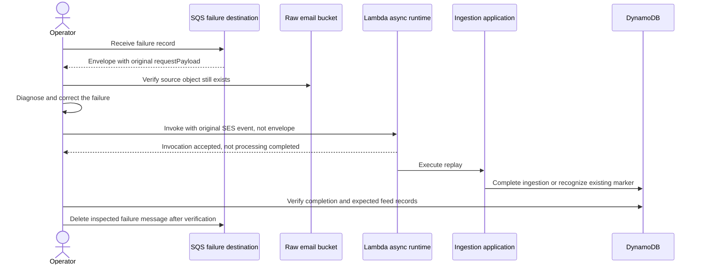

An asynchronous invocation acceptance is not proof of successful processing.
Inspect subsequent logs and storage outcomes before deleting the failure record.
Replaying a malformed event or unchanged rejected verdict does not itself fix
the underlying cause. Failure cleanup must not delete published jobs or markers.

## Cross-cutting concurrency, idempotency, and rollout

SES/Lambda delivery is at-least-once. Completion markers provide duplicate-safe
publication per SES message ID, not exactly-once model execution or deduplication
of equivalent vacancies received in different emails.

The marker precheck is a performance optimization. The first transactional item
conditionally creates the marker; all jobs are in the same transaction.
Concurrent model outputs cannot partially overwrite a winning ingestion if their
marker condition fails. Zero-job messages use the same completion mechanism.

Record batches are processed sequentially after full metadata/verdict validation.
There is no outer transaction covering multiple emails, and no per-SKU workers,
SQL locks, scheduler leases, or in-process job queue.

AWS SDK API call timeouts are 90 seconds for Bedrock, 15 seconds for S3, and
10 seconds for DynamoDB. Bedrock attempts are capped at 40 seconds within the
overall call budget. The default Lambda timeout is 180 seconds. HTTP integration
timeout is 15 seconds; HTTP requests do not perform inference.

GitHub Actions serializes deployments by target environment with
`cancel-in-progress: false`. Both plan and apply jobs use the GitHub environment
`production`, even when Terraform targets `dev`. Terraform state is separate per
target environment and uses encrypted S3 storage with lock files. These deployment
locks do not serialize live Lambda invocations.

Roll out application code and its new environment configuration together. A
default handler requires all table, model, email, and feed variables at construction.
Legacy opaque records remain separate from typed feed records and are not migrated
or automatically published.

SES rule creation is opt-in and references an existing rule set. Terraform never
activates a rule set, changes DNS, or verifies a domain. Review preceding/following
rules, TLS requirements, accepted verdicts, and model inference destinations before
enabling real mail. Micro/Lite quality evaluation and live dev acceptance are
still required before production rollout.

Pushing to `main` currently triggers a prod apply/deploy. Manual workflow runs can
target dev with `apply=false` for a plan or `apply=true` for deployment. The default
infrastructure includes a public feed API even while SES integration is disabled.

## Persistence model

| Storage / item | Identity | Responsibility and retention |
| --- | --- | --- |
| DynamoDB feed job | `pk=FEED#jobs`, `sk=<receivedAt>#<jobId>` | Validated publication fields, ID, receipt time, and internal source message ID. No configured TTL. |
| DynamoDB processed message | `pk=EMAIL#<messageId>`, `sk=METADATA` | Completion marker and numeric `jobCount`, including zero; no expiry. |
| DynamoDB legacy payload | Caller-supplied `pk`/`sk` | Internal opaque `payload` access; not the feed schema. |
| Private email S3 bucket | `<email_object_prefix><messageId>` | Raw MIME with SSE-S3 encryption and lifecycle expiry after 30 days. |
| Encrypted SQS failure queue | AWS-assigned message identity | Wrapped asynchronous invocation failure, retained up to 14 days. |
| CloudWatch log group | `/aws/lambda/<function-name>` | Application/platform logs; default retention 14 days. |
| Terraform state S3 backend | `itzitzo-jobs-feed/<environment>.tfstate` | Persistent infrastructure ownership, separate from application data, with encryption and S3 lock files. |

The application table uses on-demand billing with string `pk` and `sk` keys.
There are no relational migrations, SQL tables, vector embeddings, or secondary
indexes. Runtime code validates record shapes when writing and reading typed jobs.

Required job fields are `id`, `sourceMessageId`, `receivedAt`, `title`, and
`description`. Optional company, location, application URL, and publication date
are omitted from DynamoDB when absent. Title/company/location are bounded to
300 characters, description to 12,000, and application URL to 2,048.

There is no stored RSS snapshot. RSS is generated from current feed records on
each request. Removing raw email or a failure envelope does not undo a committed
publication; deleting a processed marker would weaken replay protection.

## Configuration and operations

| Variable / setting | Default / source | Purpose |
| --- | --- | --- |
| `AWS_REGION` | Supplied by Lambda | SDK region; do not set this reserved key in the Lambda environment map. |
| `BEDROCK_MODEL_ID` | Environment tfvars: `eu.amazon.nova-micro-v1:0` | Nova model/profile used by Converse. Lite can be explicitly selected instead. |
| `DYNAMODB_TABLE_NAME` | Terraform-generated environment-specific table | Jobs, markers, and legacy items. |
| `EMAIL_BUCKET_NAME` | Terraform-generated private bucket | Raw email retrieval. |
| `EMAIL_OBJECT_PREFIX` / `email_object_prefix` | `incoming/` | Shared SES/S3 lookup prefix. |
| `FEED_TITLE` / `feed_title` | `Itzitzo Jobs` | RSS channel title. |
| `FEED_DESCRIPTION` / `feed_description` | `Recent job vacancies received by email.` | RSS channel description. |
| `FEED_PUBLIC_URL` | Generated API endpoint plus `/feed.xml` | Atom self-link and default channel website. |
| `FEED_WEBSITE_URL` / `feed_website_url` | Feed URL unless explicitly configured | RSS channel website link. |
| `enable_ses_receipt_rule` | `false` | Opt in to receipt rule and SES delivery/invoke permissions. |
| `ses_receipt_rule_set_name` | Empty; required when enabled | Existing reviewed SES rule set; not activated by Terraform. |
| `ses_recipient` | Empty; required when enabled | Single receiving email address. |
| `bedrock_resource_arns` | Derived standard Nova model/profile resources | Explicit override for custom profiles and underlying model ARNs. |
| `lambda_memory_size` / `lambda_timeout_seconds` | 1,024 MiB / 180 seconds | Lambda capacity and execution limit. |
| `log_retention_days` | 14 | Application CloudWatch log retention. |
| `alarm_actions` | Empty list | SNS actions for Lambda error, async-drop, and destination-delivery alarms. |
| API stage throttling | Rate 10, burst 20 | Default HTTP API route throttling settings. |
| `TF_STATE_BUCKET` | Required GitHub Actions variable | Persistent Terraform backend bucket. |
| `AWS_ROLE_ARN` | GitHub Actions secret | OIDC role assumed by deployment jobs; no static AWS keys in the workflow. |
| Workflow `environment` / `apply` | Manual defaults: `dev` / `false` | Target tfvars/state and whether to apply/deploy. Push to `main` targets prod. |

The runtime IAM role permits the configured email-prefix read, application table
operations, configured Nova invocation resources, failure-queue delivery, and
log writes. The default standard-model policy includes the selected foundation
model across regions plus its configured inference profile; confirm the profile's
destination geography rather than assuming inference remains in one region.

Useful Terraform outputs and CloudWatch metrics are:

```text
feed_url
email_bucket_name
ingestion_failure_queue_url
AWS/Lambda: Errors
AWS/Lambda: DestinationDeliveryFailures
AWS/Lambda: AsyncEventsDropped
```

The feed is intentionally public. Route only appropriate job-related email to
ingestion and review extraction quality before publication; schema validation and
prompt instructions are not a guarantee that AI-generated content is factually
correct or free of private text. Protect raw email, failure records, logs, direct
Lambda invocation, and Terraform state with IAM.

Failure alarms use five-minute sum periods, a threshold above zero, and missing
data treated as not breaching. They notify people only when `alarm_actions` is set.
Application health alone does not establish email delivery, model access, or
failure-destination correctness.

## Tests

Run application checks and create the deployable artifact with:

```sh
./gradlew test lambdaZip
```

The suites cover legacy actions, event routing, verdict rejection, multi-record
retry, duplicate publication, strict Converse output handling, MIME normalization
and size bounds, DynamoDB transactional races/pagination, and RSS/HTTP behavior.
AWS SDK clients are mocked or replaced with test stores; these are not live
SES delivery or Bedrock quality tests.

After provider initialization, run the infrastructure scenarios with:

```sh
terraform -chdir=infra test
```

Terraform scenarios use a mocked AWS provider to verify safe defaults, receipt
action ordering, rejection of missing SES configuration, and unsupported model
configuration without explicit permissions. The deployment ZIP must exist first.
The plan job also runs these scenarios with its downloaded artifact path.

Live dev acceptance must separately prove SMTP delivery to S3, invocation using
the selected Nova profile, stored jobs, public RSS retrieval, duplicate replay,
and failure-destination recovery. Compare Micro and Lite on representative
approved samples before selecting the production model. See the
[feature specification](../.github/issues/feature_email_to_rss.md) and
[README](../README.md) for setup and replay instructions.
